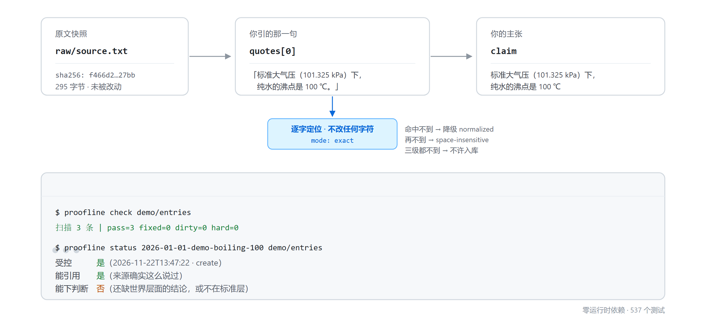

<div align="center">

<picture>
  <source media="(prefers-color-scheme: dark)" srcset="docs/assets/cover-dark.png">
  
</picture>

<h1>proofline</h1>

<p><strong>每条主张都要能在原文里定位到。定位不到，就不许入库。</strong></p>

<p>
  <a href="LICENSE"></a>
  <a href="#"></a>
  <a href="#"></a>
  <a href="#"></a>
</p>

<p>
  <a href="#30-秒上手">30 秒上手</a> ·
  <a href="#三条硬规则笔记软件一条都不管">三条硬规则</a> ·
  <a href="#它不做什么">它不做什么</a> ·
  <a href="#和同类差在哪">和同类差在哪</a> ·
  <a href="docs/manual.md">完整说明</a>
</p>

</div>

---

**文献摘抄的原文核验器 + 改动审计器——不是参考文献管理器。**

按`条目`入库的，必须同时给齐 **原文、引文、出处**，缺一样就进不来。
（`实测` 档用复现脚本代替原文，`判断` 档必须写明推自哪几条。）

它不产 BibTeX、不管 `[1]` 编号、不判断引文支不支持你的主张——那是 Zotero 和你的事。
它管的是另一件事：**这句话到底是不是原文说的**，以及**这条记录有没有被人改过**。

零运行时依赖，纯 Node（>= 20）。

## 30 秒上手

```bash
git clone https://github.com/Fire81192/proofline.git
cd proofline
npm run demo
```

`demo` 会跑四步：先看一个干净的库，然后**手改一条 entry.md**（模拟绕过工具），再 check 一次，最后把改动恢复原样。

```
③ 再 check 一次
   扫描 3 条 | pass=3 fixed=0 dirty=0 hard=0
   未受控 1 条（在工具之外被写或改过，不能当依据）：
     2026-01-01-demo-altitude  与最后一次入库记录不符——在工具之外被改过

   注意「pass=3」和「未受控 1 条」同时出现——这不矛盾：
     pass    说的是「三个文件的形状都合规」
     未受控   说的是「有一条的内容和它入库时不一样了」
```

**它拦不住你改文件——你有写权限。但它记得住每条内容是什么时候、以什么方式进来的。**

改了之后，那条不会「变成假的」，只会「不算数」：仍在库里、能读能查，但不再被当成依据。

## 三条硬规则，笔记软件一条都不管

1. **引文必须是原文里连续的一段**，定位不到就不许入库。书写差异分三级判断（`exact` 逐字 / `normalized` 全半角归一 / `space-insensitive` 忽略空白），**命中的级别会记下来**——宽松命中会被明确说出来，不静默通过。三级都在找「同一段连续的字」，不是语义近似。
2. **「来源说过什么」和「是不是真的」是两个独立维度**，互不抵扣。来源再硬，也推不出世界为真。
3. **写进来的每条都有留痕**。绕过工具手改的，`check` 点名（退出码 1）、`status` 不给引用、`index` / `review` / `stats` / 地图一律降级。**留痕文件本身读不了时，全库按「不能引用」处理**——不是「不判」。

这三条背后是六道检查和两个维度的判定规则，配了三张图：[docs/mechanism.md](docs/mechanism.md)。

## 它不做什么

- 不判断你的引文是否**支撑**你的主张——机器只核「原文里有没有这句话」，语义判断是人的事
- 不联网、不调模型、不生成内容
- 不替代笔记软件的编辑体验

## 和同类差在哪

| 项目 | 管什么 |
|---|---|
| [ProofGate](https://github.com/christopherlhammer11-ai/proofgate) | 发布前的声明核查（JSON manifest） |
| [REP](https://github.com/PerryLink/dsh-research-core) | 研究记录的证据协议（库） |
| [Alexandria](https://github.com/stanleytejakusuma/alexandria) | 会话与笔记 → 综合成 wiki |
| **proofline** | **引进来之后的逐条审计** |

一句话：**它们查「发出去之前」，proofline 查「引进来之后」。**

## 文档

| 文件 | 讲什么 |
|---|---|
| [docs/mechanism.md](docs/mechanism.md) | **三张图**：四步生命周期、六道检查、两个维度。想知道「为什么这么设计」从这里看 |
| [docs/manual.md](docs/manual.md) | 完整说明：启动、建条目、依据三档、两个维度、组织、输出 |
| [docs/commands.md](docs/commands.md) | 31 个命令，按用途分组 |
| [AGENTS.md](AGENTS.md) | 给 AI 读的规矩：它该怎么帮你写条目、什么不许猜 |
| [Releases](https://github.com/Fire81192/proofline/releases) | 每个版本改了什么。**包括修了哪些「说了没做」的** |

## 写不进去的时候，先看这几条

失败信息够用，但有几条限制只有踩到才知道。**全是硬闸，不是建议。**

| 限制 | 值 | 在哪 |
|---|---|---|
| claim 长度 | 8–200 字符 | `LIMITS.claimMinChars` / `claimMaxChars` |
| 单条引文长度 | ≤ 1000 字符 | `quoteMaxChars` |
| 引文条数 | ≤ 12 | `maxQuotes` |
| 缺口条数 | ≤ 12 | `maxGaps` |
| 佐证条数 | ≤ 12 | `maxCorroborations` |
| 条目 id 格式 | `YYYY-MM-DD-小写字母数字` | `ID_RE` |
| `run` 的 `--expect` | 值必须是**字符串** | 忘加引号写成 `{"mae": 4.02}` 会被拒（`run_expect_uncheckable`） |

**id 必须带日期前缀，中间只能是小写字母、数字、连字符。** 中文 id、大写字母、下划线都不收。

**`expect` 的值必须加引号。** YAML 会把 `4.02` 读成数字，而数字没法在输出文本里「逐字」比对——所以写入时拒、读时也拒，两头都不放。**这一条特别容易踩**，因为看起来只是少两个引号。

**数值匹配有边界。** `1.5` 在 `1.5-2` 里算**不匹配**——因为 `-` 被当成「同一个标识符的一部分」（负号）。这条是有意的：`1.5.0` 里找 `1.5` 必须不中，否则版本号一律误判。**如果你的输出写成区间，run 的 expect 就核不上。**

**快照路径必须用正斜杠。** `raw\verify-1.txt` 会被判「路径不安全」，因为反斜杠在不同平台上含义不同。写 `raw/verify-1.txt`。

## 它防的是手滑，不是绕过

`.trace.jsonl` + `.trace.head` 能查出「哪条、什么时候、以什么方式进来的」，**但挡不住有人把这两个文件一起重写**。

**那一步没有防线，只有记录。**

把库放进 git 之后，重写 trace 就是一次 commit——不是「改不了」，是「改了会留下一次 diff」。正常写入的 diff 是「一行 trace + 一条 entry」，所以某次 diff 里 trace 整份变了，那一次就可疑。

**也要知道 git 挡不住什么**：只有本地仓库时，`reset --hard` + `reflog expire` + `gc` 能把历史抹掉；有远程副本时，改写才需要 force push，而那是一次显式动作。

所以准确的说法是：**它的链条不保证「改不了」，只保证「改了会留下痕迹」；痕迹本身也可能被抹，但抹这个动作要付出一串显式的代价。**

**它不能证明「没被销毁」，只能证明「库里的东西没被悄悄改过」。**

## 已知局限

**每条都写「怎么发现它正在发生」。** 没有可观测信号的局限，等于「不知道」——那比不写更糟。

| 局限 | 怎么发现 |
|---|---|
| `guard` 的 CLI 版没有挂点，只能手动跑 | 它从没被自动调用过，所以也没有信号。这一条只能靠你记得跑 |
| dsh 有 `tools/pre-execute` 和 `tools.guard` 两个钩子，但**插件还没写** | 同上。写完之后，直接写 `entry.md` 会被拦 |
| `audit` 跳过 4MB 以上的文件 | 扫大目录时，报出的文件数比实际少 |
| `scan` 和 `import --code` 的上限是 512KB | 大文件抽不出候选，`scan` 的候选数比预期少 |
| 数值校验只验证过 43 条，误报率未知 | 看到 `run_expect_missing` 先人工核对：是真变了，还是边界判断误伤 |
| `source_sha256` 哈希的是**解码后的字符串** | 非 UTF-8 的快照，`sha256sum 文件` 对不上工具记的值 |
| trace 能被整体重写 | `git status` 里 `.trace.jsonl` 和 `.trace.head` 同时变，而 `entry.md` 没变 |
| **删掉 trace 里某条记录再 `--reseal`，能完全洗白**（写入会先被 `trace_shrunk` 拦住，但 reseal 是显式出口） | `trace` 显示「链头已清掉」的那一次，就是承认删过。**唯一真防线还是 git** |
| `audit` 的邮箱正则加了长度上界（本地 64 / 域名 253） | 超过这个长度的畸形邮箱不报——但那种东西本来也不是邮箱 |

### 不判断的东西

引文命中了，但它**支不支持**这个主张——机器一句话不说。

```
claim: 中国标准 35 对应 WHO 第一阶段过渡目标
quote: 「二级浓度限值为 35 μg/m³」     ← 逐字命中，但它没提 WHO
```

工具判 `supported`，因为它只核「原文里有没有这句话」。

**这个空洞是有意的**：语义判断交给人的原因不是技术做不到，是判错了没法申诉。

## 许可

MIT。见 [LICENSE](LICENSE)。

判定语义受 [REP v1](https://github.com/PerryLink/dsh-research-core) 启发；三级引文匹配与留痕链头是自研。
