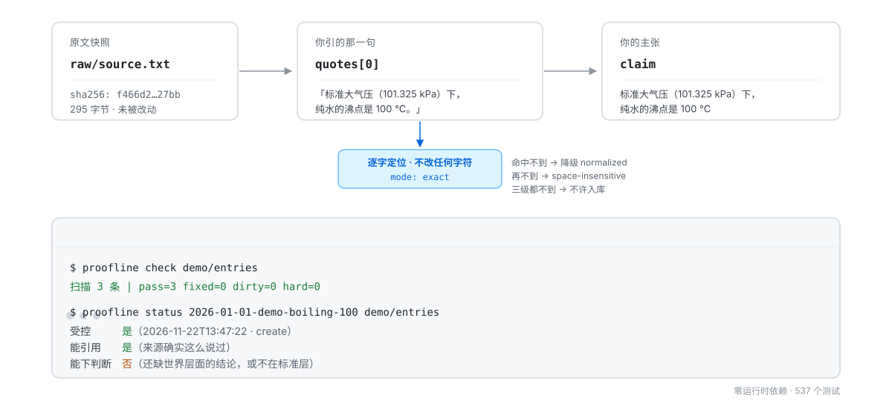

<div align="center">



<h1>proofline</h1>

<p><strong>每条主张都要能在原文里定位到。定位不到，就不许入库。</strong></p>

<p>
  <a href="LICENSE"></a>
  <a href="#"></a>
  <a href="#"></a>
  <a href="#"></a>
</p>

<p>
  <a href="#30-秒上手">30 秒上手</a> ·
  <a href="#三条硬规则笔记软件一条都不管">三条硬规则</a> ·
  <a href="#它不做什么">它不做什么</a> ·
  <a href="#和同类差在哪">和同类差在哪</a> ·
  <a href="docs/manual.md">完整说明</a>
</p>

</div>

---

给写东西需要引用的人用的。存一句话进来，它同时要三样：**原文、引文、出处**。
缺一样，这条就进不来。

零运行时依赖，纯 Node（>= 20）。

## 30 秒上手

```bash
git clone https://github.com/Fire81192/proofline.git
cd proofline
npm run demo
```

`demo` 会跑三步：先看一个干净的库，然后**手改一条 entry.md**（模拟绕过工具），再 check 一次。

```
① 现在这个库是干净的
   扫描 3 条 | pass=3 fixed=0 dirty=0 hard=0

② 模拟一次绕过：直接改 entry.md 里的一个数字
   已改。

③ 再 check 一次
   扫描 3 条 | pass=3 fixed=0 dirty=0 hard=0
   未受控 1 条（在工具之外被写或改过，不能当依据）：
     2026-01-01-demo-altitude  与最后一次入库记录不符

   受控         否
   能引用        否（未受控——内容没经过入库闸门）
```

**它拦不住你改文件——你有写权限。但它记得住每条内容是什么时候、以什么方式进来的。**

改了之后，那条不会「变成假的」，只会「不算数」：仍在库里、能读能查，但不再被当成依据。

## 三条硬规则，笔记软件一条都不管

1. **引文必须逐字命中原文快照**。分三级从严到宽（`exact` / `normalized` / `space-insensitive`），宽松命中会被明确说出来，不静默通过。
2. **「来源说过什么」和「是不是真的」是两个独立维度**，互不抵扣。来源再硬，也推不出世界为真。
3. **写进来的每条都有留痕**。绕过工具手改的，`check` 点名、`status` 不给引用、证据册不计入可引用。

## 它不做什么

- 不判断你的引文是否**支撑**你的主张——机器只核「原文里有没有这句话」，语义判断是人的事
- 不联网、不调模型、不生成内容
- 不替代笔记软件的编辑体验

## 和同类差在哪

| 项目 | 管什么 |
|---|---|
| [ProofGate](https://github.com/christopherlhammer11-ai/proofgate) | 发布前的声明核查（JSON manifest） |
| [REP](https://github.com/PerryLink/dsh-research-core) | 研究记录的证据协议（库） |
| [Alexandria](https://github.com/stanleytejakusuma/alexandria) | 会话与笔记 → 综合成 wiki |
| **proofline** | **引进来之后的逐条审计** |

一句话：**它们查「发出去之前」，proofline 查「引进来之后」。**

## 文档

| 文件 | 讲什么 |
|---|---|
| [docs/manual.md](docs/manual.md) | 完整说明：启动、建条目、依据三档、两个维度、组织、输出 |
| [docs/commands.md](docs/commands.md) | 31 个命令，按用途分组 |
| [AGENTS.md](AGENTS.md) | 给 AI 读的规矩：它该怎么帮你写条目、什么不许猜 |

## 已知局限

- `guard` 命令挂不上宿主，**从没在真实动作上生效过**
- `audit` 对超过 4MB 的文件直接跳过，不扫
- 数值校验（`value.number` 是否在引文里）只验证过 43 条，误报率未知
- `source_sha256` 哈希的是解码后的字符串，非 UTF-8 快照无法用 `sha256sum` 对账

## 许可

MIT。见 [LICENSE](LICENSE)。

判定语义受 [REP v1](https://github.com/PerryLink/dsh-research-core) 启发；三级引文匹配与留痕链头是自研。
