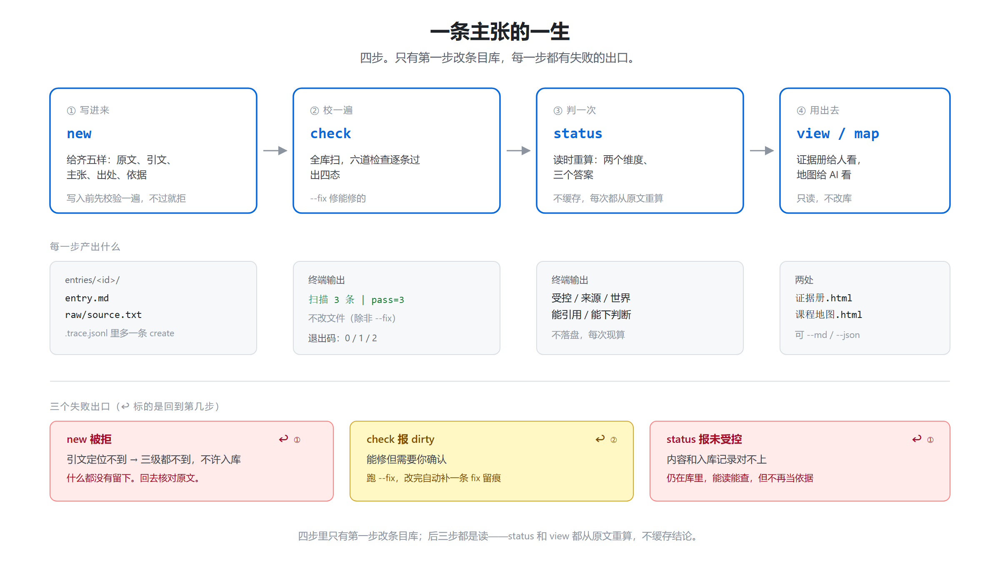
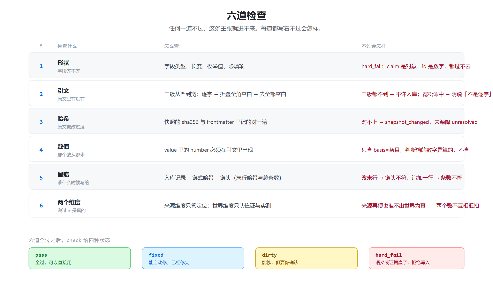
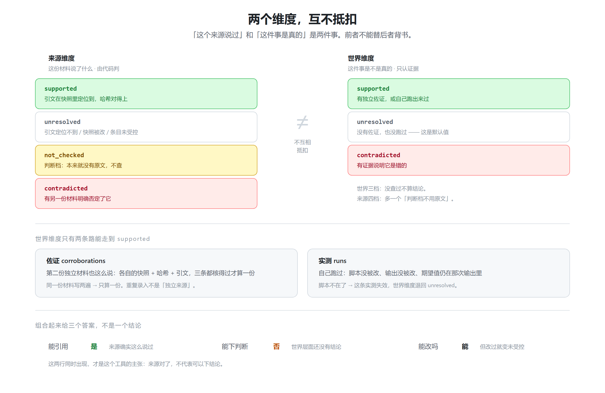

# 机制

三张图：一条主张怎么进来、凭什么被引用、四步走完是什么样。

细节（字段契约、降级规则、代码位置）在 [manual.md](manual.md)。

---

## 〇、四步



只有第一步会**改条目库**。后三步都不改条目——`status` 和 `view` 每次都从原文重算，不缓存结论。

两个例外要说清：`check --fix` 会写回机械修复（它自己也会留痕），`view` / `map` 会生成 HTML——但那是给人看的东西，不是条目。

这条设计的原因很实际：缓存会让「三个月前判过是 supported」变成一个没人复核的既成事实。

---

## 一、六道检查



六道全过才写进库。**每一道都写着「不过会怎样」**，因为拒绝的时候必须说清理由——
`hard_fail` 只说一句「不合规」，等于让人猜。

四态的含义：

| 状态 | 意思 | 你该做什么 |
|---|---|---|
| `pass` | 全过 | 直接用 |
| `fixed` | 能自动修，已经修完 | 什么都不用做，`--fix` 会处理 |
| `dirty` | 能修，但要你确认 | 看它列出的修复项，确认后跑 `--fix` |
| `hard_fail` | 语义或证据废了 | 回去看原文，这条现在进不来 |

---

## 二、两个维度



### 为什么两个维度用同一套五态取值，判法却不一样

来源常见的是 `not_checked`：判断档（`basis: 判断`）本来就没有原文，
它不是「没查到」，是「压根不需要查」——推出来的东西不该要求原文有。

世界维度也允许填 `not_checked`，但**填了永远不算「有结论」**（`DECIDED` 只认
`supported` / `contradicted`）。所以实际用起来世界一般只出现三种：
有证据、还没证据、有反证。

### 三条硬规则

**一、来源再硬，也推不出世界为真。**

`evidence_status: supported` 只说明「这句话原文里确实有」。它可能是：
- 原文自己写错了
- 原文是十年前的
- 原文说的是另一件事，只是这句话字面上像

所以 `world_status` 默认 `unresolved`，要改它只有两条路（佐证 / 实测）。

**二、两条路都要核「还在不在」。**

- 佐证：快照在、哈希对、引文还定位得到——三条缺一不算
- 实测：脚本在、输出在、期望值还在那次输出里——缺一不算

**脚本删了，那条实测就失效。** 这不是设计缺陷，是它不肯替虚假背书。

**三、同一份材料写两遍，只算一份。**

判据是「同一个快照 + 同一个哈希」——那是同一份材料，只是重复录入。
不判「来源独不独立」（那是人的事），但重复录入不是独立性问题。

### 两个维度怎么组合

| 来源 | 世界 | 能引用 | 能下判断 | 这是什么情况 |
|---|---|---|---|---|
| supported | supported | 是 | 是 | 唯一能下判断的格子 |
| supported | unresolved | 是 | **否** | 最常见：话确实说过，但还不确定真假 |
| supported | contradicted | 是 | 否 | 原作说过，但后来被推翻 |
| contradicted | 任意 | 否 | 否 | 这份材料本身被判为错的——它说过什么都不作数 |
| conflicting | 任意 | 否 | 否 | 几份材料互相冲突，还没定 |
| unresolved | 任意 | 否 | 否 | 连「说过」都做不到 |
| not_checked | 任意 | 否 | 否 | 判断档，只能当线索 |

**注意第二行。** 这是这个工具存在的主要场景：**能引，但不能据此下结论。**

大部分笔记软件到这里就停了——它只能告诉你「记过」，不能告诉你「所以呢」。

---

## 三、为什么不用一个分数

有过这个想法：把两个维度合成一个 0-100 的可信度。

否决的理由是具体的：**合成分数会让「来源对但世界未知」和「来源错但世界已知」看起来一样。**

而这两件事的处理方式完全相反——前者去查证，后者去换引文。

分数把它们压成同一个数，人就分不出该做哪件事了。

---

## 四、这套东西的边界

它不判断语义。引文命中了，但它**支不支持这个主张**，机器一句话不说。

例：

```
claim: 中国标准 35 对应 WHO 第一阶段过渡目标
quote: 「二级浓度限值为 35 μg/m³」     ← 逐字命中
```

这句话确实在原文里，但它**没提 WHO**。工具会判 `supported`，因为它只核「原文里有没有这句话」。

这个空洞是有意的：**语义判断交给人的原因不是技术做不到，是判错了没法申诉。**
